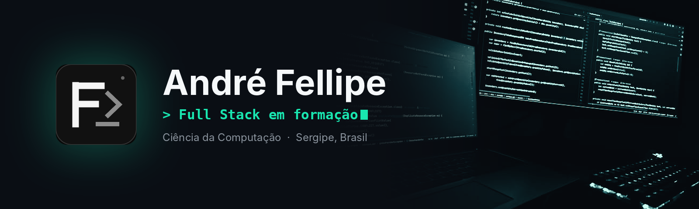
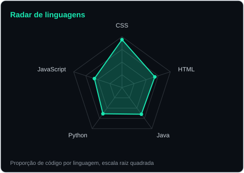
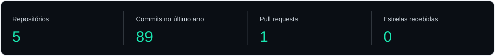

  

<h2 align="center">Sobre mim</h2>

## Sobre mim

Fala! Eu sou o André Fellipe, de Sergipe, estudante de Ciência da Computação e apaixonado por tecnologia. Minha jornada na programação começou pela curiosidade de entender como as coisas funcionam e, desde então, venho transformando essa curiosidade em aprendizado, projetos e novas experiências.

Atualmente, estou construindo minha trajetória como desenvolvedor Full Stack, aprofundando meus conhecimentos em desenvolvimento web e explorando diferentes tecnologias. Acredito que cada projeto é uma oportunidade de aprender algo novo, melhorar minhas habilidades e transformar ideias em soluções reais.

- 🌱 **Evoluindo agora:** React, Node.js e TypeScript.
- 💻 **Tecnologias que estudo:** HTML, CSS, JavaScript, Java e Python.
- 🚀 **Meu objetivo:** evoluir como desenvolvedor e construir projetos cada vez mais completos.
- 🤝 **Conexões:** aberto a trocar conhecimentos, colaborar em projetos e conhecer pessoas da área de tecnologia.

<h2 align="center">Linguagens e atividade</h2>

  
  
   
  

<h2 align="center">Contatos</h2>

  
  
  

 

  

