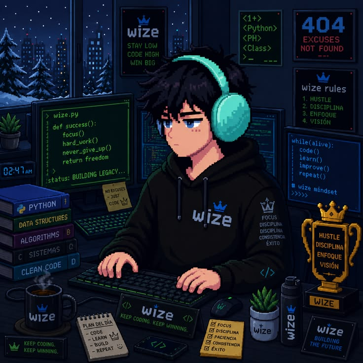

# Olá, seja muito bem-vindo! 👋

*Desenvolvedor Full Stack em formação · Sergipe, Brasil*

  

  

 

## 👨‍💻 Sobre mim

Oi! Meu nome é **André Fellipe**, sou de Sergipe, Brasil, e estudo **Ciência da Computação** (4º período), construindo minha trajetória rumo ao **Full Stack**.

Comecei pela curiosidade de entender como as coisas funcionam por dentro. Hoje, essa curiosidade virou código.

  
  

## 🛠️ Stack

### Front-end

### Back-end

### Em consolidação → Full Stack

## 📊 Atividade

  

