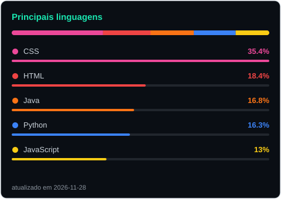

<!-- Coloque suas imagens em assets/: banner.png (topo) e rodape.png (final) -->

  

<h2 align="center">Sobre mim</h2>

Oi! Meu nome é **André Fellipe**, sou de Sergipe, Brasil, e estudo **Ciência da Computação** (4º período). Comecei pela curiosidade de entender como as coisas funcionam por dentro. Hoje, essa curiosidade virou código.

<!-- Exemplo de linha extra: - 🚀 **Construindo agora:** nome do seu projeto -->
- 🔭 **Objetivo:** construir minha trajetória rumo ao **Full Stack**
- 🌱 **Estudando:** React, Node.js e TypeScript
- 💬 **Pergunte-me sobre:** Java, Python e JavaScript
- 🤝 **Aberto a:** trabalhos freelance (sites e projetos web)
- 📫 **Dúvidas?** É só chamar pelos contatos abaixo

<h2 align="center">Linguagens e atividade</h2>

<!-- Estes cards são gerados sozinhos pela GitHub Action (scripts/generate_cards.py) -->

  
  
   
  

<h2 align="center">Contatos</h2>

<!-- TROQUE os trechos em MAIÚSCULO pelos seus dados, ou apague o badge que não for usar -->

  
  
  
  
  

 

  

